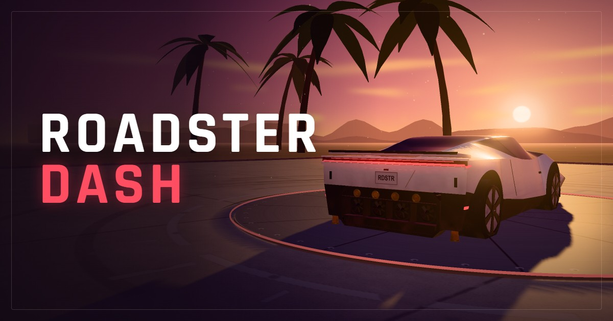

# PlayRoadster 🏎️✨

An endless 3D arcade highway runner inspired by Tesla Roadster Dash, GTA Vice City sunset aesthetics, and Subway Surfers collectible mechanics. Built with TypeScript, Three.js, and Web Audio API.



## 🌴 Features

- **Iconic Visual Style**: GTA Vice City Art Deco ocean drive buildings, sunset lighting, palm trees, and coastal beach scenery.
- **Authentic Vehicle Physics**: Smooth lane changing, cold-gas thruster puffs, active aero wing, suspension dynamics, jump physics, barrel rolls, front flips, and power slams.
- **Subway Surfers Collectible System**:
  - Golden collectible coins with 3D metallic luster and embossed emblems.
  - Parabolic jump arcs matching the exact ballistic trajectory of the Roadster.
  - Lead-in runways and magnetic collection vacuum.
  - On-screen coin counter and HUD.
- **Intelligent NPC Traffic**: Sedans, SUVs, taxis, limousines, and buses with turn signals, dynamic brake lights, and collision detection.
- **Audio & VFX**: Procedural Web Audio engine sounds, supersonic jump blasts, thruster boosts, near-miss whooshes, speed lines, and post-processing bloom.
- **Customizable Settings**: Modal controls for master volume, engine volume, SFX volume, speed lines toggle, and high-performance shadows.

## 🎮 Controls

| Action | Keyboard | Touch / Mobile |
| :--- | :--- | :--- |
| **Steer Left / Right** | `A` / `D` or `←` / `→` | Swipe Left / Right |
| **Jump** | `Space` / `W` / `↑` | Tap Screen |
| **Boost / Thruster** | `Shift` | Tap & Hold Boost |
| **Mid-Air Roll** | `A` / `D` or `←` / `→` (in air) | Swipe Left / Right (in air) |
| **Front Flip** | `Space` / `W` / `↑` (in air) | Tap (in air) |
| **Power Slam** | `S` or `↓` | Swipe Down |
| **Pause** | `P` or `Esc` | Pause Button |
| **Mute** | `M` | Mute Button |

## 🚀 Getting Started

### Prerequisites

- Node.js (v18 or higher recommended)
- npm

### Installation

```bash
# Clone the repository
git clone git@github.com:7h3Y055/playroadster.git
cd playroadster

# Install dependencies
npm install

# Start local development server
npm run dev
```

The game will be running at `http://localhost:5173`.

### Production Build

```bash
npm run build
npm run preview
```

## 🛠️ Tech Stack

- **Three.js**: 3D rendering, procedural shaders, lighting, and materials
- **TypeScript**: Strict typing and game state management
- **Vite**: Rapid HMR development and optimized production bundling
- **Web Audio API**: Real-time synthesized vehicle and SFX audio
- **Vanilla CSS**: Responsive design and HUD styling

## 📄 License

MIT
